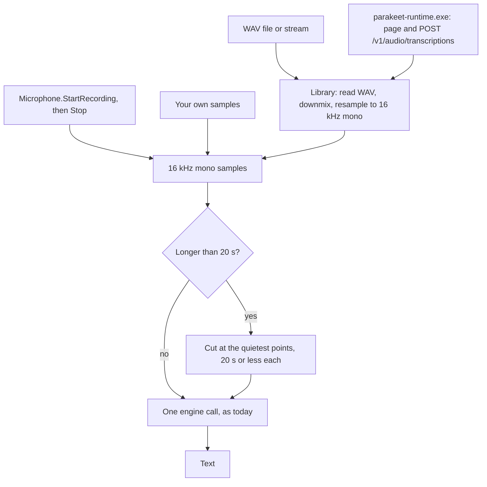

# Council result, session 1: the consumer interface of ParakeetRuntime

Council: fable (leader), opus (builder), sol (consultant), astra (verifier), neon (tester). 2026-11-23.
The session stopped at its 50-message limit. Every numbered point was agreed or dropped and all five members
accepted the design below. One detail was settled by the leader after the last objection and is listed under
"Open at the stop".

Paths below are relative to `C:\Users\Krzysiek\.councils\parakeet-consumer-api\` unless they start with
`src\`, `docs\` or `scripts\` (the repository) or name a PrivateType or LocalBuddy file.

## The answer in short



- **Library**: one package, no new dependency. `EnsureInstalledAsync()`, `TranscribeWavAsync(path or stream)`,
  `TranscribeAsync(samples)` of any length, `Microphone.StartRecording()` then `Stop()`. Hello world is 5 lines
  for a WAV (with its `using`) and 4 more for the microphone (neon counted).
- **Microphone**: push-to-talk, in memory, the way PrivateType does it. PrivateType never writes WAV files: it
  keeps 16 kHz PCM in memory while the shortcut is held and sends one in-memory WAV to a local server on release.
- **Exe**: a double-click (or `serve`) opens a page on `127.0.0.1` where you drop a WAV and read the text; the same
  thing is `POST /v1/audio/transcriptions` (multipart `file`, the request shape of OpenAI's transcription route).
  Also `transcribe <file.wav>`, `record`, `download`.
- **The finding that shaped it**: transcribing long audio in one engine call, which is what the engine does today
  up to 399 s, loses whole sentences. Cutting at the quietest point into pieces of 20 s or less brings it back to
  short-clip accuracy. So every entry point cuts.

## Evidence

| Claim | Evidence | Checked by |
| --- | --- | --- |
| Long audio in one call is badly wrong; cutting fixes it | Word error rate, whole call → cut at the quietest point (≤ 20 s): EN 60 s 32.24% → 6.19%, EN 2 min 43.38% → 5.99%, PL 60 s 8.86% → 6.02%, PL 2 min 9.92% → 6.14%. Short-clip baseline 5.25–5.76% (`docs\benchmarks.md:415-417`); the whole-call loss was already on record at `docs\benchmarks.md:455-459`. RTX 5070 Ti, pinned Q8_0 model, FLEURS concatenations (23 + 12 English, 22 + 11 Polish clips), 2026-11-23. Script `fable\proto\run-long.ps1`, results `fable\proto\results-*.txt`. | astra reran all 16 runs; transcripts byte-identical (`astra\verify-long.md`). opus measured the same effect with its own cutter (`opus\proto\p1\p1-run1.txt`). |
| 20 s is the right piece length | Cut length 10 / 15 / 20 / 25 / 30 s: EN 2 min 6.82 / 5.78 / 5.99 / 6.55 / 7.19%, PL 2 min 7.53 / 6.10 / 6.14 / 6.42 / 6.70% (`fable\proto\results-threshold.txt`). 15–20 s is the flat best. | not rerun by others |
| Cutting does not hurt just above 20 s | 4 FLEURS clips of 20–23 s: whole 10/35 and 11/108 word errors, cut 6/35 and 8/108. Too few clips to prove a gain. | astra reran |
| The cut policy matters | LocalBuddy's live policy (fixed loudness threshold, cut at every 700 ms pause, hard cut at 20 s) gives 10.5–13.8% on the same audio. | astra reran |
| The model's own limit is 399 s | `src\ParakeetRuntime\ParakeetModel.cs:138` with the position tensor's 9,999 rows. | sol and astra, each from the GGUF header |
| A managed WAV reader and resampler need no NAudio | opus's reader v2 (`opus\proto\lib\WavAudio.cs`, about 200 lines): transcripts identical to NAudio WDL on 30/30 clips at 48 kHz and at 44.1 kHz, 25/30 at 8 kHz; a 10-minute 48 kHz stereo file converts in 0.8–1.0 s (WDL 0.5–0.6 s). | astra replayed; neon ran malformed inputs (5 failures in v1, fixed in v2, 2 one-line fixes left) |
| Microphone capture needs no package | `fable\proto\Microphone.cs` (327 lines): WASAPI through raw COM vtable calls on its own thread; Windows converts to 16 kHz mono float. Device list, a 3 s recording (47,967 samples), the cap and the stale-device error all ran. | astra reran; neon ran it from an STA thread |
| The README snippets compile and run against the public API alone | `opus\proto\hello` (an assembly without access to internals, on a copy of the library with A1–A4, A6 and fable's `Microphone.cs`): the WAV snippet transcribed 127 s of English in 3.0 s including model load (RTX 5070 Ti); the microphone snippet recorded 3.00 s. The copy still used the name `TranscribeFileAsync`. | not rerun |
| How PrivateType captures the microphone | `DefaultMicrophoneCapture.cs:25-29`, `OfflineRecognizer.cs:11-12, 234-260`, `EngineHost.cs:33` | all five read it |
| Kestrel fits the single-exe release | One 103.3 MB exe once the IIS in-process module is excluded from publish (`sol\Test-KestrelBundle.ps1`); 73.9 MB without Kestrel; start time equal within noise (`opus\proto\test-servers-run1.txt`). | astra reran both |
| Uploads need not touch disk | `MultipartReader` into bounded memory; temp folder empty after uploads. | astra |
| Neither host checks the Host header by itself | `curl -H "Host: evil.example:5093"` answers 200 on Kestrel and on HttpListener (opus). | not rerun |
| `Dispose` on a UI thread can deadlock today | `src\ParakeetRuntime\SpeechEngine.cs:44-54, 64-76`; deterministic reproduction and fix in `sol\Test-Dispose.ps1`. | astra reran |

Not verified by anyone: real speech through the microphone (the room was silent), unplugging a microphone during
capture, the integrated server with every guard (the second half of opus's `p4` was in progress at the stop; the
server prototypes that ran had no guards yet), peak memory of block-wise conversion, cold start of a compressed
single-file exe, and any OpenAI SDK against the route (only curl-shaped multipart requests were run).

## The design

Sections are lettered (`A3`, `C2`).

### A. Library: public surface

Existing types stay (`SpeechModel`, `SpeechModelFile`, `SpeechEngine`). New: `SpeechEngineOptions`,
`Microphone`, `MicrophoneDevice`, `MicrophoneRecording`. No new package dependency; Windows is still
reached only through P/Invoke (new: `ole32.dll` for WASAPI).

```csharp
public sealed class SpeechModel
{
    // A1. new: does nothing when installed, otherwise downloads and verifies with its own HttpClient
    public Task EnsureInstalledAsync(IProgress<double>? progress = null, CancellationToken cancellationToken = default);
    // unchanged: Default(), IsInstalled, Path, DownloadAsync(http, progress, ct), InstallFromFileAsync(path, progress, ct)
}

// A2. new
public sealed record SpeechEngineOptions(bool UseGpu = true, string? GpuNameContains = null);

public sealed class SpeechEngine : IDisposable
{
    public static Task<SpeechEngine> LoadAsync(SpeechModel speechModel, SpeechEngineOptions? options = null, CancellationToken cancellationToken = default);

    public string Backend { get; }       // "GPU: NVIDIA GeForce RTX 5070 Ti (D3D12)" or "CPU (AvxVnniInt8)"
    public bool IsUsingGpu { get; }      // false when UseGpu was true but no usable or matching GPU was found

    // A3. changed: any length. Audio longer than 20 s is transcribed in pieces cut at its quietest points
    //     and the texts are joined with a space. 20 s or less is transcribed exactly as today.
    public Task<string> TranscribeAsync(float[] samples16KhzMono, CancellationToken cancellationToken = default);

    // A4. new: an uncompressed WAV: PCM 8/16/24/32-bit or IEEE float 32/64-bit (also as WAVE_FORMAT_EXTENSIBLE),
    //     1 to 8 channels, 8,000 to 192,000 Hz, up to 2 hours of audio.
    public Task<string> TranscribeWavAsync(string path, CancellationToken cancellationToken = default);
    public Task<string> TranscribeWavAsync(Stream wav, CancellationToken cancellationToken = default);   // read from its position, left open, need not seek
}

// A5. new
public sealed record MicrophoneDevice(string Id, string Name);

public static class Microphone
{
    public static IReadOnlyList<MicrophoneDevice> Devices();
    public static MicrophoneRecording StartRecording(MicrophoneDevice? device = null, TimeSpan? longest = null);   // default device, 10 minutes
}

public sealed class MicrophoneRecording : IDisposable
{
    public TimeSpan Duration { get; }
    public float Level { get; }           // loudness of the latest packet, 0 to 1, for a meter
    public bool IsRecording { get; }      // false after Stop, after `longest`, or after a device failure
    public float[] Stop();                // 16 kHz mono; throws IOException if the device failed
    public void Dispose();                // stops; without Stop the audio is cleared and dropped
}
```

Rules:

- A3/A4: cancellation is honoured between pieces; a piece that has started finishes (as today).
- A4 errors: `FileNotFoundException`; `InvalidDataException` for anything outside the envelope above, with a
  message that names what is supported. Sizes are checked before anything is allocated. A WAV that ends before
  the audio it declares is an error that says how much is missing; a streamed WAV (data size 0xFFFFFFFF) is read
  to its end. Non-finite float samples are rejected.
- A4 limit: 2 hours is the v1 bound on decoded audio; it is this version's memory bound, not the model's. The
  reader converts in bounded blocks (read, downmix, resample, append), so peak memory is the 16 kHz result
  (460 MB at 2 hours) whatever the input rate; a whole-file buffer at 192 kHz would need 5.5 GB (sol, neon).
  Passing blocks straight into the cutter would lift the bound and is a listed follow-up.
- A6: every `await` inside the engine's gate uses `ConfigureAwait(false)` (fixes a UI-thread `Dispose` deadlock).
- A3 detail: 20 s means 320,000 samples exactly; 320,000 is one call, 320,001 is cut. The model's own 399 s limit
  stays internal and is not an input limit.
- A7: not in v1: continuous microphone transcription, timestamps, formats other than WAV, progress for long files.

Snippets (the README's):

```csharp
using ParakeetRuntime;

var model = SpeechModel.Default();
await model.EnsureInstalledAsync();                      // 714 MB, once
using var engine = await SpeechEngine.LoadAsync(model);
Console.WriteLine(await engine.TranscribeWavAsync("hello.wav"));
```

```csharp
using var recording = Microphone.StartRecording();
Console.WriteLine("Speak, then press Enter.");
Console.ReadLine();
Console.WriteLine(await engine.TranscribeAsync(recording.Stop()));
```

### B. How microphone input works

- PrivateType (answer to the owner's question): it never writes a WAV file. WASAPI shared mode with
  automatic conversion gives 16 kHz mono PCM; the app keeps it in memory while the shortcut is held and, on
  release, sends one in-memory WAV to a local server (`DefaultMicrophoneCapture.cs:25-29`,
  `OfflineRecognizer.cs:11-12, 234-260`, `EngineHost.cs:33`).
- The library does the same without the server: `Microphone.StartRecording()` opens the device through WASAPI
  (raw COM vtable calls, as `D3D12Native.cs` does), asks Windows for 16 kHz mono float, and keeps packets in
  memory on its own thread; `Stop()` returns the samples; `TranscribeAsync` cuts them when longer than 20 s.
- Gates for the implementation: exact `longest` cap (or documented packet granularity), no exception escaping a
  worker thread, bounded start and stop, clear messages for "no microphone" and "access denied", and a manual
  check with real speech and an unplug (the council could test neither).

### C. The exe

Commands:

| Command | What it does |
| --- | --- |
| `parakeet-runtime` (no arguments) or `serve [--port 5092] [--device cpu\|gpu\|gpu:<name>] [--no-browser]` | Serves the page and the API on `127.0.0.1`, opens the page. |
| `transcribe <file.wav> [--device …]` | Prints the text to stdout; messages go to stderr. |
| `record [--device …]` | Records the default microphone until Enter, prints the text. |
| `download [--from <file>]` | Installs the model (from a local copy with `--from`). |
| `--help`, `--version`, the benchmark flags | As today; `--help` prints the usage that no arguments printed before. |

C1. Routes:

- `GET /`: the page, one embedded HTML file with no external assets.
- `GET /health`: `{ "status": "no-model" | "downloading" | "loading" | "ready" | "failed", "progress": 0.43, "version", "backend", "model", "error" }`; HTTP 200 when ready, 503 otherwise.
- `POST /v1/audio/transcriptions`: `multipart/form-data` with one `file` part (a WAV) and optional
  `response_format` = `json` (default, `{"text":"…","duration":17.54}`, duration = seconds of audio) or `text`. Other fields are ignored. Errors are
  `{"error":{"code","message"}}` with 400 (malformed request or WAV), 413 (too large), 415 (not a WAV),
  422 (longer than 2 hours),
  503 (busy or model not ready).

C2. Rules for the server (implementation gates; each gets a test):

- Kestrel (`FrameworkReference Microsoft.AspNetCore.App`) in the Cli project only; bound with
  `Listen(IPAddress.Loopback, port)`, ambient Kestrel configuration switched off; the IIS in-process module
  excluded from publish so the release folder still holds one exe.
- Every request: `Host` must be exactly `127.0.0.1:<port>`, the address the exe prints and opens. Neither Kestrel
  nor HttpListener checks this by itself (opus measured both answer 200 to a foreign Host). POST: a present `Origin`
  must be the server's own; a present `Sec-Fetch-Site` must be `same-origin`. No CORS headers.
- The upload is parsed with `MultipartReader` into bounded memory, never to disk; exactly one `file` part; byte cap
  (default 256 MiB, independent of the 2-hour audio bound) answered with 413; a body is read only after admission,
  so one upload is in memory at a time.
- One transcription runs and one waits; a third gets 503. A disconnected waiter leaves the queue. A started
  transcription finishes and its lease is held until then.
- Nothing is logged about audio or text.

C3. The model at first start (council: explicit download everywhere, as in the library):

- `serve` starts and opens the page at once, also without a model. `/health` then says `"status": "no-model"` with
  the model's source URL, exact size and target folder. The page shows these and one **Download model** button.
- `POST /model/download` starts the one process-owned install; progress is in `/health`, so a refreshed tab picks
  it up. This route needs the server's own `Origin` and the header `X-Parakeet-Request: 1`, because it uses
  714 MB of network and disk. When the install ends the engine loads and the status becomes `ready`.
- Headless: `parakeet-runtime download` first. `serve` without a model prints that command and the URL;
  `transcribe` and `record` without a model stop with the same message.

C4. The page: model and backend status, a drop zone and file picker for a WAV, the text, audio length and time
taken, a copy button, and the `curl` line that does the same. The layout goes to the owner as a mockup before any
UI code (owner's rule).

### D. README outline

1. What it is, status.
2. Try it in a minute: download the exe, run it, the page; `curl.exe -F file=@hello.wav http://127.0.0.1:5092/v1/audio/transcriptions` (`curl.exe`, because `curl` is an alias in Windows PowerShell 5.1); `transcribe hello.wav`; `record`.
3. Use it in your app: `dotnet add package ParakeetRuntime`; WAV snippet; microphone snippet; your own samples
   (`TranscribeAsync(float[])`); CPU or GPU (`SpeechEngineOptions`, `Backend`); model folder and offline install.
4. What to expect: WAV only and which WAVs; long audio is cut at pauses about every 20 s; silence can produce a
   stray word; languages; a dated speed table naming machine, model and audio.
5. HTTP API: routes, errors, limits, local only.
6. The speech model, Verify a download, Requirements, Help, License (as today, absolute links).

### E. Implementation order (each step ends with its check)

1. `ConfigureAwait(false)` under the gate, with sol's deterministic UI-context test.
2. `EnsureInstalledAsync`: tests for "already installed does nothing" and "downloads through a fake handler".
3. `SpeechEngineOptions`, `Backend`, `IsUsingGpu`: test on CPU; GPU test skips without a GPU.
4. WAV reader + fast resampler: unit tests for every format and for neon's and sol's malformed inputs (non-seekable
   stream, truncated data, odd rates with a bounded filter table, non-finite samples, RIFF bounds, a chunk size of
   0xFFFFFFFF, a header that declares more than the body holds); conversion in bounded blocks with a peak-memory
   check on a 2-hour 192 kHz file; transcript
   comparison against NAudio WDL on 30 clips at 8, 44.1 and 48 kHz; conversion time recorded in `docs/benchmarks.md`.
5. Cutter + `TranscribeAsync` of any length + `TranscribeWavAsync`: tests for 320,000 and 320,001 samples, no
   sample lost, speech with no quiet window, an odd tail, cancellation between pieces; WER before/after on
   long60 and long120, English and Polish, into `docs/benchmarks.md`; the policy into `docs/model-and-decoding.md`.
6. `Microphone`: device-gated tests; the gates in B; `docs/` page.
7. Exe: `transcribe`, `download`, `record`, `--help`; `Test-ReleaseArtifacts.ps1` still passes.
8. Exe: `serve` API with the C2 tests and a smoke test of the published single file.
9. Page: mockup, owner's approval, then the embedded page and the UI check.
10. README and docs; speed figures re-measured.
11. Separate release step: single-file compression, kept only if the combined Kestrel build repeats the size gain
    (opus: 103.6 → 50.3 MB) and cold start, warm start, idle memory (opus: 15 → 52 MB), model load and signing pass.

## Open at the stop

1. **The bound on decoded audio.** The draft said 2 hours. sol and neon showed that 2 hours is 460 MB only after
   resampling: a whole-file buffer at 192 kHz would be 5.5 GB. Both named the same two ways out: a 10-minute (sol)
   or 1-hour (neon) bound, or converting in bounded blocks with a proven peak. The design above takes blocks and
   keeps 2 hours, with a peak-memory check in step 4. The session ended before sol and neon confirmed that choice;
   if the check fails, the fallback is their lower bound.
2. **Not built yet**: the server with every guard in C2 and C3 (opus was building it), and the page.

Closed in the last exchange: a truncated WAV is an error (opus conceded to sol, astra and fable; neon accepted),
and all five accepted sections A–E (sol with its three edits, astra with `duration` in the JSON answer and
`curl.exe` in the README, opus, neon).

## Tried and rejected

| Idea | Why it lost |
| --- | --- |
| Transcribe a file whole and reject only above the model's limit (sol, astra at first) | The limit is 399 s, so a one-minute English file would return 32% wrong words with no error. |
| Keep `TranscribeAsync(float[])` as one whole call and add a second method that cuts (sol, astra, neon at first) | The microphone snippet, and any app with its own capture, would call the short name and get the bad path. Nothing is released, so there is no contract to keep; the one existing caller (LocalBuddy) already cuts at 20 s. |
| Continuous microphone transcription in v1 (fable) | The only measured live policy scored 10.5–13.8%. It needs its own design and measurement. The brief asks for PrivateType's way, which is push-to-talk. |
| NAudio in the library, or a second package for the microphone (astra, opus as options) | 327 lines of WASAPI and about 200 lines of WAV code do it with no dependency and equal transcripts. |
| winmm `waveIn` for capture (opus, neon as an option) | A second capture technique where WASAPI is measured working; winmm cuts device names at 31 characters. |
| The microphone as `engine.StartMicrophone()` (neon) | Recording needs no engine; an app can record while the model loads. |
| HttpListener instead of Kestrel (opus) | It saves 30 MB but needs a hand-written multipart parser, has no request-abort signal, and binds through HTTP.sys instead of an app-owned loopback socket. |
| A required custom header on the transcription route (sol) | It breaks plain `curl -F` and OpenAI-style clients; an Origin and Sec-Fetch-Site check covers the cross-site case. The header stays on the download route. |
| Converting other audio formats, or recording the microphone, in the browser (fable, opus) | Two conversion paths. One conversion lives in the library. |
| Downloading the model automatically when `serve` starts (fable, opus) | A double-click must not start 714 MB of traffic unasked. |
| "PrivateType works with the exe unchanged" (fable) | PrivateType starts `nemo-speech.exe` with its own flags and needs `GET /ready` (`EngineHost.cs:50, 169-170, 308-315`). Only the request shape matches. |
| A raw `audio/wav` request body beside multipart (neon, astra at first) | One request shape. |
| The name `TranscribeFileAsync` (fable, opus, neon) | The method takes only WAV; the name should say so. |
| Single-file compression as part of this work (opus) | Orthogonal; it became step 11 with its own checks. |

## Follow-ups the council named

- Continuous microphone transcription with a measured cut policy.
- Decoding in blocks into the cutter, to lift the 2-hour bound; a progress callback for long files.
- Other audio formats, in the library.
- Timestamps. The cut offsets are not word timings and must not be presented as such.
- The model can invent a word on silence: 1.5 s of near-silence gave "Yeah." (`fable\proto`, command `record 3 1.5`).
  The README says so; a silence check is a possible later step.
- `CorpusBench` can move from NAudio to the library's reader, which removes NAudio.Core from the exe.
